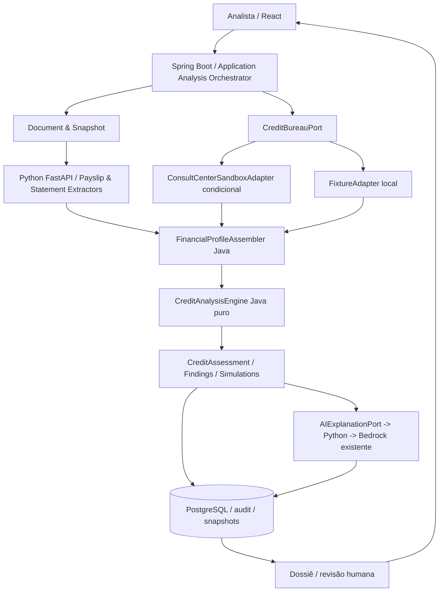

# 02 — Arquitetura alvo, fluxo, portas e persistência

## Contexto

Blueprint V3 seções 6–8 define React → Java (autoridade) → PostgreSQL/storage/Python → Bedrock, com fronteira de confiança. Seções 9–15 definem `Proposal`, `DocumentVersion`, snapshot, `Analysis`, `Extraction`, `Finding`, `PolicyVersion`, `AIExplanation`, `Decision` e auditoria. **Preservar todos os invariantes V3 INV-01 a INV-12.**

## Diagrama lógico (não adicionar deploys por módulo)



Diagrama representa dependências de caso de uso, não garante que a consulta externa sempre ocorra. Adapter acessa o bureau apenas mediante ação explicitamente autorizada para teste e dados sintéticos.

## Responsabilidades

- **Orchestrator/application:** captura `analysisId`, snapshot documental e policyVersion; solicita extração; solicita consulta bureau se configurada; registra status por fonte; compõe `FinancialProfile`; chama engine; persiste; solicita explicação; conclui estado.
- **Extractor Python:** lê cada arquivo, entrega campos identificados, status por campo e evidência específica (`docId`, `docVersion`, `page`, `excerpt`). Em extratos, entrega transações com direção, data, valor, descrição original; classificação pode ser `UNKNOWN`.
- **Bureau adapter:** lê credenciais de configuração, executa HTTP, traduz vendor JSON → `BureauReport` estável, valida dados; não implementa regra bancária.
- **Assembler:** resolve competências, normaliza unidade monetária e origem; mantém conflitos/ausências como status; não presume renda por depósito.
- **CreditAnalysisEngine (puro):** aplica regras e cálculos; recebe apenas objetos de domínio, `CreditPolicy` e cenário; retorna assessment sem I/O.
- **Bedrock:** explica assessment já calculado, sem mudar indicadores ou status de regra.

## Sequência correta (mudança potencial em relação ao V3)

```text
1 POST proposta (existente)
2 POST documentos tipados/versionados (existente, ampliar)
3 POST criar análise idempotente -> persistir snapshot + policyVersion
4 Executar extração Python (3 payslips + 3 statements), verificar evidenceRefs
5 Executar bureau sandbox opcional (se habilitado) + persistir fonte/status
6 Montar FinancialProfile (dados validados, incerteza explícita)
7 Executar CreditAnalysisEngine Java e persistir assessment/findings/simulation
8 Solicitar explicação Bedrock com assessment+policyRefs+evidenceRefs validados
9 Persistir explicação com status AVAILABLE/UNAVAILABLE/INVALID_OUTPUT
10 GET dossier exibe tudo separado + revisão/decisão humana autorizada
```

**Ponto crítico:** no V3 a sequência ilustra Python consultando Bedrock enquanto processa documentos, antes da avaliação Java. Se o código atual fez isso, desacoplar **extração** de **explicação** sem reescrever o cliente Bedrock. Pode haver duas operações de Python ou uma nova rota de explicação; escolher após inspecionar contratos atuais. Não pedir ao LLM que calcule limites.

## Integração hexagonal — exemplo orientativo

```java
public interface CreditBureauPort {
    BureauReport consult(BureauQuery query);
}
public interface CreditAssessmentUseCase {
    CreditAssessment assess(AnalysisInput input);
}
public interface AIExplanationPort {
    AIExplanation explain(CreditAssessment assessment, EvidenceContext context);
}
```

`BureauQuery` deve receber referência à pessoa + finalidade/ambiente e idempotency/correlation pertinentes, mas nunca credencial do browser. Para PoC, CPF sintético somente. O use case usa a porta, não a implementação `ConsultCenter`.

## Estados e fontes

Por fonte: `AVAILABLE`, `MISSING`, `AMBIGUOUS`, `INVALID`, `UNAVAILABLE` e `MOCK` como **atributo de ambiente/provedor**, não como substituto de status. Bureau não consultado = `NOT_REQUESTED`; erro de upstream = `UNAVAILABLE`, nunca 0 restrições. A análise pode estar `COMPLETED` quanto ao processamento documental e ainda `BUREAU_UNAVAILABLE`; registrar componentes/status separadamente.

## Persistência mínima

Usar modelos atuais se já comportarem JSONB e vínculo versionado. Caso contrário, considerar migrations aditivas:

- `financial_assessment`: `id`, `analysis_id` UNIQUE/FK, `policy_version_id`, `profile_json`, `result_json`, `created_at`; inclui versões da regra e parâmetros de simulação.
- `bureau_consultation`: `id`, `analysis_id`/`proposal_id`, `provider`, `product`, `environment`, `status`, `consulted_at`, `response_schema_version`, `normalized_json`, `raw_response_object_ref` opcional com retenção/autorização; identificação sintética do titular por referência interna, não CPF em log.
- Se necessário, estender `document_metadata.type` para `PAYSLIP`/`BANK_STATEMENT` sem alterar versões existentes.

**Evitar** replicar informações pessoais sem necessidade, duplicar dados de extrato em dezenas de tabelas ou sobrescrever `analysis` anterior. A inclusão de bureau no fingerprint deve usar referência estável/hash do resultado e status capturado; não usar nova consulta automática sem registrar nova versão do input.

## Falhas e resiliência

- Erro PDF: `INVALID`, sem valor presumido.
- Campo ambíguo: `AMBIGUOUS`, pendência humana.
- Bureau timeout/401/429/5xx: `UNAVAILABLE`, circuito simples de falha/timeout; nada de retry infinito; análise documental prossegue.
- Bedrock timeout/schema inválido: preservar assessment determinístico, exibir explicação indisponível.
- Duplo clique: mesma `Idempotency-Key`/payload → mesmo ID; payload divergente → 409.
- Tentativa antiga: `lease_token` e update condicional existentes no V3.
- Versionamento: documentos e relatório externo usados na análise ficam fixados; re-upload cria nova análise.
