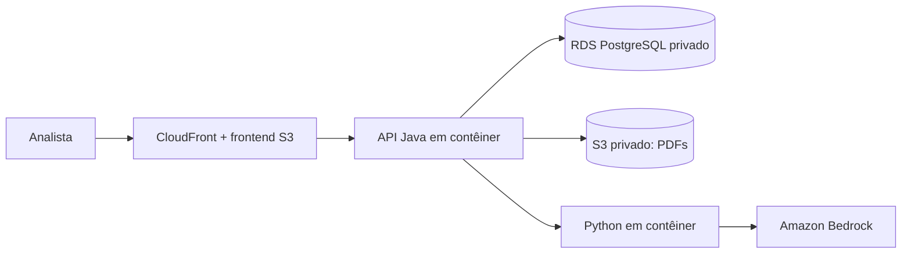

# Atualização vigente — runtime da PoC (21/11/2026)

As notas históricas abaixo registram execuções anteriores e não definem mais o runtime atual. A execução vigente usa `AI_PROVIDER=bedrock` com `BEDROCK_MODEL_ID=deepseek.v3.2` e `BUREAU_MODE=sandbox`. Compose, Spring, Python e os scripts de smoke devem manter esses valores como padrão. O mock permanece somente em testes determinísticos que o selecionam explicitamente; não é fallback de execução.

O bureau sandbox é uma chamada HTTP real ao ambiente de homologação do Consult Center. A resposta é marcada como `SANDBOX`; indisponibilidade ou resposta inválida não é convertida em mock.

# Plano de implementação — Credit Intelligence

Status: documento histórico de execução. Para o estado atual, consulte o [Blueprint V3.1](../Credit_Intelligence_Master_Blueprint_V3.docx), o [guia de execução local](../../docs/LOCAL-SETUP.md) e o [relatório E2E V3.4](../../CREDIT_INTELLIGENCE_V3_4_E2E_REPORT.md). O baseline local está operacional; a combinação atual de bureau real e Bedrock real permanece parcial, e AWS não é provisionada automaticamente.

## Localização e fontes

- A raiz do repositório `creditintelligence/` receberá o código e os artefatos executáveis: `backend-java/`, `document-intelligence-python/`, `frontend/`, `fixtures/`, `infra/` e `openspec/`.
- `development/` continuará sendo a fonte do Blueprint, das instruções, skills, prompts e deste plano. Não mover esses arquivos para a raiz.
- Criar na raiz somente um `AGENTS.md` curto que instrua o agente a ler `development/AGENTS.md` e o Blueprint antes de trabalhar. Esse arquivo é um ponto de entrada; as regras continuam mantidas em `development/`.
- Ajustar o README e `development/scripts/setup-openspec.ps1` para execução a partir da raiz, com caminhos explícitos, verificação real de versões/comandos e checagem do resultado do OpenSpec. Não inicializar OpenSpec sobre configuração existente.

## Sequência proposta

1. **G0 — baseline reproduzível.** Criar estrutura do monorepo, build Maven dentro do Docker, ambiente Python, Compose com PostgreSQL, Java e Python, `.env.example`, README de execução e um smoke test. O modo `local-mock` funciona sem AWS. Saída: `docker compose up --build` inicia serviços saudáveis; comandos de build/teste documentados e executados.
2. **Primeira fatia vertical — proposta e documento.** Criar proposta, consultar proposta e enviar PDF digital sintético com versão, checksum, limite de tamanho e validação de assinatura. Persistir metadados com Flyway e guardar o arquivo em storage local privado. Proteger os endpoints com identidade de demonstração desde sua criação. Saída: testes de API/DB e upload válido/inválido (T01–T04), sem efeitos indevidos.
3. **Extração e análise determinística.** Implementar contrato tipado Java ↔ Python, extrair campos com página/evidência, representar ausência ou ambiguidade sem inventar fatos, aplicar regra Java e política fictícia versionada, produzir dossiê. Saída: T05–T08 e testes de contrato, com referências ao documento e snapshot corretos.
4. **Explicação de IA e decisão humana.** Começar com provedor mock determinístico, schema de resposta e validação de todas as referências; falha ou referência inventada produz estado controlado. Registrar decisão autenticada ligada a uma análise e versão documental explícitas. Saída: T09–T11, T17–T18 e cenário de prompt injection; IA não altera fatos, regras ou decisão.
5. **Confiabilidade e jornada.** Implementar idempotência persistente, conflito de chave, concorrência e proteção contra tentativa antiga; preservar histórico após novo documento. Criar UI React mínima para a jornada e testar falhas e E2E local. Saída: T12–T16, T19–T20 e gates G1–G5 com comandos, ambiente e resultados observados.
6. **Pós-PoC.** CI, observabilidade ampliada e Terraform apenas após E2E local e evidências P0/P1. AWS real, push e provisionamento exigem autorização separada; mock e integração real ficam identificados.

## Regras para cada fatia

- Abrir uma mudança OpenSpec pequena, com contrato, critérios de aceite e testes; implementar somente a mudança ativa.
- Respeitar Java como autoridade de estado, regras e decisão; Python apenas extrai e explica. Usar dados sintéticos e snapshots imutáveis.
- Executar build, lint, testes unitários, integração/contrato e smoke relevantes. Registrar comando, ambiente, resultado e bloqueios; não marcar teste não executado como PASS.
- Fazer revisão independente primeiro em modo somente leitura, registrar defeitos, corrigir na implementação e repetir a verificação. Commit local somente para unidade verificada.
- Não criar recursos AWS, publicar código ou alterar a stack sem autorização explícita.

## Destino AWS proposto

Imagens Java e Python iriam para ECR; App Runner é o candidato inicial de execução, condicionado a um teste da comunicação privada entre Java, Python e RDS. A [documentação AWS de VPC Connector](https://docs.aws.amazon.com/apprunner/latest/dg/network-vpc.html) descreve a saída do App Runner para recursos privados, e a [documentação de variáveis e segredos](https://docs.aws.amazon.com/apprunner/latest/dg/env-variable-manage.html) cobre a injeção via Secrets Manager. Antes de fechar região e modelo Bedrock, verificar acesso e eventual inferência entre regiões segundo a [documentação de perfis de inferência](https://docs.aws.amazon.com/bedrock/latest/userguide/inference-profiles-support.html). Preparar Terraform e estimativa de custo depois da jornada local; provisionar somente após revisão concreta dos recursos e autorização.

## Quadro visual de execução — 20/11/2026

| Gate | Entrega | Situação | Evidência necessária |
| --- | --- | --- | --- |
| G0 | Compose, Java, Python, PostgreSQL | 🟢 PASS | Build Java concluído; três serviços healthy; health UP; Flyway V1 aplicada |
| G1 | Proposta e documentos | 🟢 PASS | T01–T04 via HTTP; 3 testes JUnit/PostgreSQL; Flyway V2; volume privado |
| G2 | Extração e contrato | 🟢 PASS | Python pytest 4/4, Ruff, contrato Java e T05–T06 |
| G3 | Regras, política, dossiê, IA mock e decisão humana | 🟢 PASS | T07–T11, T17–T18; 8 testes Java, 5 Python e smoke HTTP |
| G4 | Confiabilidade e segurança do MVP local | 🟢 PASS | Idempotência, concorrência, retry, fencing, autenticação humana, falhas de IA/documento, referências inválidas e decisão final verificados; OIDC/TLS de produção ficam para a etapa AWS |
| G5 | UI e jornada | 🟢 PASS | Build/lint/format; jornada no navegador com proposta, PDF, análise e decisão humana; OpenSpec validado e arquivado |
| AWS | Infraestrutura demonstrativa | 🔴 bloqueada por SCP | `ec2:DescribeVpcs` negado explicitamente pela SCP `p-7gcyevpl`; não criar infraestrutura até o bloqueio ser removido pela conta de gerenciamento |
| Bedrock local | Explicação opcional via Qwen3 Next 80B A3B | 🟢 PASS | Modelo ativo/autorizado; pytest 7/7, Ruff, Java 12/12, health Compose, smoke mock e smoke Bedrock passaram; STS removido e provider voltou a `mock` |

Fluxo pretendido: `PDF sintético → Python (evidências) → Java (regras) → dossiê → decisão humana`.

## Estado observado em 20/11/2026

- Raiz Git originalmente continha apenas `LICENSE` versionado; `development/` não rastreado. A base Compose/Java/Python foi criada nesta etapa.
- Java 21 e Node 26 executam. Python do host é um alias WindowsApps indisponível; Python roda na imagem Docker. O daemon Docker 29.7.2 respondeu após acesso permitido fora do sandbox.
- OpenSpec CLI foi executado via `npm exec` e inicializado sem sobrescrever configuração prévia; mudanças G1 e G2 foram validadas e arquivadas.

## Evidência G0 — 20/11/2026

- `docker compose config --quiet`: PASS.
- `docker compose --progress plain up --build -d`: build Java `BUILD SUCCESS`; primeira inicialização encontrou a porta 8080 ocupada no host. Ajustada a publicação para `127.0.0.1:18080` e separado o backend em rede de entrada e rede privada.
- `docker compose up -d` e `docker compose ps --format json`: três serviços `running` e `healthy`.
- `Invoke-RestMethod http://127.0.0.1:18080/actuator/health`: `status=UP`.
- `docker compose exec -T postgres psql -U credit_app -d credit_intelligence -tAc 'select version, success from flyway_schema_history order by installed_rank desc limit 1'`: `1|t`.
- Testes automatizados de negócio ainda não existem. O Maven compilou com `-DskipTests`; G1 deve incluir T01/T02 antes de avançar.
- AWS: perfil CLI `bedrock` detectado. Nenhuma chamada a serviços ou recurso cloud nesta etapa.

## Evidência G1 — 20/11/2026

- OpenSpec `proposals-documents`: quatro artefatos completos; `openspec validate proposals-documents --strict` passou.
- `docker compose --profile test run --rm backend-test`: 3 testes JUnit, 0 falhas, 0 erros, 0 ignorados; Spring/Flyway conectados ao PostgreSQL 16.6.
- `powershell -ExecutionPolicy Bypass -File scripts/smoke-proposals.ps1`: T01 criação/consulta PASS; T02 400/404/401 PASS; T03 upload PDF, checksum e versões 1/2 PASS; T04 arquivo inválido 422, PDF sem texto 422 e 10 MiB+ 413, sem metadado adicional, PASS.
- `docker compose exec -T postgres ... flyway_schema_history`: V1 e V2 com `success=true`. Quatro uploads válidos de duas execuções do smoke: 4 metadados, 4 chaves únicas e 4 objetos no volume. Os três serviços estavam `healthy`.
- Testcontainers ainda não está configurado; os testes usam o PostgreSQL real do Compose. A primeira tentativa de startup detectou tipos JPA incompatíveis com `CHAR`; foram corrigidos com tipo JDBC explícito e o backend voltou a iniciar.

## Evidência G2 / G3 parcial — 20/11/2026

- `docker compose --profile test run --build --rm document-intelligence-test`: 4 testes pytest passaram; contrato, extração, ausência, ambiguidade, checksum e token interno. `ruff check app tests`: PASS.
- `docker compose --profile test run --rm backend-test`: 6 testes Java passaram, 0 falhas/erros/ignorados. Um teste envia evidência de documento fora do snapshot e observa `FAILED_PERMANENT`, sem campos ou findings persistidos.
- `powershell -ExecutionPolicy Bypass -File scripts/smoke-analysis.ps1`: T05/T07/T08 PASS com `8000.00` versus `7500.00`, referência de página e `WARNING`; T06 PASS para ausência e ambiguidade sem fato inventado; T16 PASS para nova versão com dossiê anterior preservado. Requisição repetida reutiliza a análise do mesmo fingerprint.
- `docker compose --progress plain up --build -d`: imagens Java/Python compiladas. Flyway V3 aplicada e três serviços saudáveis. A API de análise é síncrona, sem alegação de execução assíncrona durável.
- A explicação mock e a decisão humana foram concluídas em G3. Bedrock real, idempotency key e concorrência ainda não estão concluídos.

## Evidência G3 — 20/11/2026

- `docker compose --profile test run --rm backend-test`: 8 testes JUnit, 0 falhas, 0 erros e 0 ignorados. Inclui resposta de IA com referência inventada e falha do provedor.
- `docker compose --profile test run --build --rm document-intelligence-test`: 5 testes pytest passaram; `ruff check app tests`: PASS. A explicação mock tipada não decide crédito.
- `docker compose --progress plain up --build -d`: build Java e Python concluído; Flyway V4 aplicada; PostgreSQL, Python e Java saudáveis.
- `powershell -ExecutionPolicy Bypass -File scripts/smoke-analysis.ps1`: T05–T09, T16–T18 e bloqueio após decisão final passaram. O teste observou decisão autenticada, snapshot obsoleto 409, sem autenticação 401, duplicata 409, e análise/upload após decisão final 409.
- A explicação permanece separada de campos e findings; o provedor observado é `MOCK`. Nenhuma chamada Bedrock real foi realizada.

## Evidência G4 — 20/11/2026

- OpenSpec `reliable-analysis` validado estritamente e arquivado. Flyway V5 cria vínculo persistente entre chave, fingerprint e análise.
- `docker compose --profile test run --rm backend-test`: 11 testes Java, 0 falhas. Três cenários novos verificam chave repetida/alterada, retry de falha Python e tentativa antiga após novo lease; apenas o lease atual persiste findings.
- `powershell -ExecutionPolicy Bypass -File scripts/smoke-analysis.ps1`: T12 PASS; mesma chave reutilizou análise, novo documento com a mesma chave retornou 409. Jornada G0–G3 permaneceu funcional.
- A primeira chamada HTTP durante o reinício da imagem encontrou conexão fechada; depois do health check `healthy`, o smoke completo passou. O script de operação deve aguardar a saúde do backend antes de enviar tráfego.
- Revalidação final em 20/11: `docker compose --profile test run --rm backend-test` — 12 testes Java PASS; serviço Python — pytest 7/7 e Ruff PASS. `smoke-analysis.ps1` validou T05–T18 e congelamento após decisão final; `smoke-bedrock.ps1` validou a explicação Qwen real com findings preservados.
- G4 está concluído para o escopo local sintético. Autenticação de produção (OIDC), TLS e recursos AWS permanecem fora do gate local e dependem da etapa de implantação, atualmente bloqueada pela SCP.

## Evidência G5 — 20/11/2026

- React/TypeScript/Vite servido por Nginx no Compose em `http://localhost:18081`, com proxy same-origin para `/api/`. PostgreSQL, Java, Python e frontend reportados `healthy` em `docker compose ps`.
- `npm run build`, `npm run lint` e `npm run format:check` em `frontend/`: PASS. O npm audit reportou zero vulnerabilidades na instalação travada.
- Jornada real no navegador com dados sintéticos: login de demonstração, criação de proposta, upload do PDF fixture, análise `COMPLETED`, evidência de página 1, finding `WARNING`, explicação `MOCK`, decisão autenticada `MORE_INFO_REQUIRED`. Snapshot obsoleto é bloqueado na UI e no backend.
- OpenSpec `analyst-workspace`: `validate --strict` passou e mudança arquivada. A caixa da tarefa de validação foi corrigida para refletir o trabalho já concluído.

## Bedrock local — 20/11/2026

- Integração de explicação Bedrock no serviço Python, limitada a explicar findings Java; `mock` permanece padrão. O modelo é Qwen3 Next 80B A3B (`qwen.qwen3-next-80b-a3b`) em `us-east-1` via Converse. Preço publicado para regiões dos EUA: US$ 0,15/1M tokens de entrada e US$ 1,20/1M de saída.
- AWS CLI confirmou modelo `ACTIVE`, `agreementAvailability=AVAILABLE`, `authorizationStatus=AUTHORIZED`, `entitlementAvailability=AVAILABLE` e `regionAvailability=AVAILABLE`.
- Primeiro smoke Bedrock falhou com `EndpointConnectionError`: o container Python estava apenas na rede interna Docker. Conectado também à rede `edge` de saída, sem publicar a porta do serviço. A policy STS foi restrita ao ARN regional do Qwen.
- Verificação: pytest 7/7, Ruff PASS, Java 12/12, `docker compose up --build -d` saudável, `smoke-analysis.ps1` PASS e `smoke-bedrock.ps1` PASS (`BEDROCK`, Qwen, finding `WARNING`). Uma chamada sintética real foi feita.
- Depois do smoke, Compose voltou ao padrão `mock`. Credenciais STS não estão presentes nos containers e `.bedrock.env` foi removido; a sessão expira em até uma hora.

## Critério de autorização

A solicitação de iniciar o desenvolvimento autorizou G0 e as fatias locais. A implantação AWS será preparada como mudança separada após os gates locais, com revisão de recursos, custos e rede.
